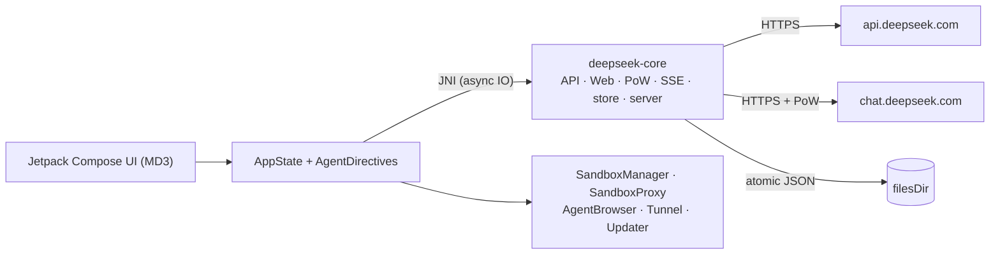

# Local API DeepSeek

Android-клиент DeepSeek на **Rust + Kotlin/Jetpack Compose (Material 3)**. Вся сетевая, потоковая и серверная логика работает в `deepseek-core` (авторизация, PoW, потоковый SSE, локальная история и OpenAI-совместимый прокси-сервер), а на стороне Android реализованы нативный Compose UI, песочница QEMU Ubuntu, управляемый браузер агента, фоновый сервис и `cloudflared`.

Два режима авторизации:

| Режим | Токен | Модель |
|---|---|---|
| **API** | `sk-…` с [platform.deepseek.com](https://platform.deepseek.com/api_keys) | модели из `/models` (по умолчанию `deepseek-flash` и `deepseek-v4-pro`), thinking, усилие `low/high/max` |
| **Web** | `userToken` с `chat.deepseek.com` | веб-сессия DeepSeek, переключатель DeepThink |

## Возможности

- **Проверка токена до сохранения** (`/models` или `/api/v0/users/settings`) с показом режима, доступных моделей и баланса (в API-режиме).
- **Стриминг и рассуждения**: потоковый вывод `reasoning_content` / `THINK`, отмена генерации, перегенерация последнего ответа без дублирования сообщения пользователя, статистика времени ответа, `tok/s` и времени размышлений.
- **Контекст и автоназвания**: оценка занятых токенов в шапке чата (с учётом system-инструкции, истории, черновика и вложений). После первого ответа отдельный короткий запрос генерирует название чата (2–5 слов).
- **Фото и медиа**: до 4 изображений за сообщение через системный пикер (асинхронное декодирование, превью и полноэкранный просмотр). В API-режиме уходят как `image_url`, в веб-режиме загружаются файлами с `ref_file_ids`.
- **Форматирование**: нативный Compose-рендерер Markdown (заголовки, списки, цитаты, ссылки, сворачиваемые GFM-таблицы с выравниванием, блоки кода с подсветкой синтаксиса, sticky-шапками, копированием и HTML-превью), формулы LaTeX через локальный KaTeX (bitmap-кэш + fallback WebView) и тег `[[font:serif|...]]`.
- **Поиск в интернете**: DeepSeek Search (`/v1/tools/search`) в API-режиме с выводом источников; нативный `search_enabled` в веб-режиме.
- **Системная инструкция и параметры**: настройка модели, рассуждений, усилия (`low/high/max`), веб-поиска и системной инструкции (хранится локально, в историю чата не пишется).
- **Офлайн-переключатель**: блокирует сетевые запросы ядра, останавливает локальный сервер, туннель, прокси песочницы и браузер агента.
- **Интерфейс**: Material Design 3 + Dynamic Color и 5 встроенных палитр, системная/тёмная/светлая тема, детальная настройка масштаба UI и шрифта, компактный режим.
- **Уведомления и автообновления**: уведомление «Ответ готов» в фоне; проверка `update.json` (при запуске и раз в 6 часов через `JobScheduler`), строгая (fail-closed) проверка SHA-256 и доверенного HTTPS-хоста, установка через системный `PackageInstaller`.

## Режим агента (песочница и браузер)

Отдельная история чатов в левом меню и изолированный `/workspace` на каждый чат (с опциональной двусторонней синхронизацией с выбранной SAF-папкой устройства).

- **QEMU + Ubuntu Base (arm64, TCG)**: постоянный ext4-образ (`rootfs.img`), установленные пакеты и файлы за пределами `/workspace` сохраняются между запусками. Настройки памяти и ядер задаются в диалоге песочницы.
- **Сеть внутри песочницы**: `eth0` (`10.0.2.15`, шлюз `10.0.2.2`) и локальный HTTP/CONNECT-прокси приложения на `127.0.0.1:18991` (запускается по требованию вместе с песочницей, блокирует loopback/LAN/private адреса от SSRF). Время UTC синхронизируется при старте, доступна команда `install-base` (`curl`, `ca-certificates`, `htop`, `procps`, `python3`, `git`, `wget`, `jq`, `dnsutils`, `iputils-ping` и др.).
- **Tool-loop и файлы**: модель выполняет shell-команды в `/workspace` с построчным выводом и кнопкой «Стоп» (`Ctrl+C`), таймаут 2 минуты (для `apt-get`/`pip`/`install-base` — 15 минут). ZIP-архивы до 40 МБ прикрепляются прямо в `/workspace`, готовые медиа до 12 МБ агент присылает через `[[SEND: /workspace/file]]`.
- **Браузер агента**: встроенный `WebView` с сохранением cookies/сессии, фильтрацией схем URL (`http`/`https`), индексацией интерактивных элементов `[1]..[N]` (включая Shadow DOM и React/Vue-инпуты) и командами `[[BROWSER: open|URL]]`, `click`, `type`, `select`, `press`, `hover`, `find`, `scroll`, `wait_for`, `extract`, `screenshot`, `back`, `forward`, `reload`, `close`.
- В инструментах агента доступны журнал событий и полноэкранный терминал Ubuntu.

## Веб-токен

1. Войдите на [chat.deepseek.com](https://chat.deepseek.com).
2. Откройте DevTools → Application → Local Storage → `userToken`.
3. Скопируйте значение целиком (подойдёт как JSON `{"value":"…","__version":"0"}`, так и сама строка `value`).

Подробная инструкция для ПК, Android и iOS — в [docs/get-token.md](docs/get-token.md).

Под капотом: `GET /api/v0/users/settings`, `chat_session/create`, `create_pow_challenge` → **DeepSeekHashV1** (SHA3-256 без Keccak round 0), `chat/completion` с заголовком `x-ds-pow-response`, разбор SSE (`THINK` / `RESPONSE`), цепочка `message_id` → `parent_message_id`.

**Ограничения веб-режима**: это неофициальный протокол. DeepSeek периодически режет такие клиенты (баны, `RISK_DEVICE_DETECTED`), меняет эндпоинты или требует Cloudflare-проверку. Для стабильной работы используйте официальный API-ключ.

## Локальный API

Включается в настройках («Локальный API», порт настраивается, по умолчанию `8787`) и работает в foreground-сервисе (`ServerService` с `WakeLock`/`WifiLock`) на `127.0.0.1:<порт>` и Unix-сокете `files/localapi.sock`. Требует `Authorization: Bearer <ключ>` из настроек (сравнение ключа в постоянное время, ограничение параллельных запросов).

```bash
curl http://127.0.0.1:8787/v1/models \
  -H "Authorization: Bearer <ключ из настроек>"

curl http://127.0.0.1:8787/v1/chat/completions \
  -H "Authorization: Bearer <ключ из настроек>" \
  -H "Content-Type: application/json" \
  -d '{"model":"deepseek-flash","messages":[{"role":"user","content":"ping"}],"stream":true}'
```

Эндпоинты: `GET /v1/models`, `POST /v1/chat/completions` (`stream: true/false`), `GET /health`. С ПК по USB можно пробросить порт: `adb forward tcp:8787 tcp:8787`.

- Рассуждения по умолчанию выключены для быстрого отклика. Включаются явно через `"thinking": {"type": "enabled"}` (`true`) или `"model": "deepseek-reasoner"`. `reasoning_effort` настраивает усилие только при уже включённом thinking.
- Для длинных ответов используйте `"stream": true`: первый чанк приходит сразу (~0.3 с), тогда как при `stream: false` ответ отдаётся целиком после завершения генерации.
- В веб-режиме сервер использует одну веб-сессию до своей остановки (потом удаляет её в фоне), передавая историю `messages` транскриптом.

## Внешний доступ: Cloudflare Tunnel

В настройках можно поднять встроенный `cloudflared` (arm64) для публичного HTTPS поверх локального API:

- **Быстрый туннель**: временный URL `https://…trycloudflare.com` без аккаунта Cloudflare. Живёт до остановки туннеля и меняется после перезапуска.
- **Именованный туннель**: Cloudflare Zero Trust → Networks → Tunnels → Public hostname с сервисом `http://127.0.0.1:8787`. Токен вставляется в приложении (на диск не сохраняется). Рекомендуется дополнительно закрыть домен через Cloudflare Access.

Особенности работы на Android: DNS edge-узлов резолвится средствами Java и передаётся через `--edge`, сертификаты берутся из встроенного `cacert.pem` (`SSL_CERT_FILE`), трафик в локальный API идёт по Unix-сокету `files/localapi.sock` в обход VPN, при обрыве связи выполняется до 4 автоперезапусков.

## Архитектура



- `core/` (`deepseek-core`) — `reqwest` (rustls), построчный SSE-парсер (`BufReader`), PoW (`pow.rs`), локальный сервер (`server.rs` на `tiny_http`), атомарное хранилище.
- `android/` — `cdylib` `liblocalapi.so`, 18 JNI-методов (`Rust.java`), JSON-конверт `{ok, data}` / `{ok:false, error:{kind,message}}`.
- `app/` — Gradle-проект: Java 17, Kotlin 2.1, Jetpack Compose BOM, `minSdk 26`, `targetSdk 35`, R8 shrinking (`minifyEnabled true`, `shrinkResources true`) для release-сборок.

## Сборка

Нужны: Rust + targets (`aarch64-linux-android`, `x86_64-linux-android`), Android SDK 35, NDK, JDK 17+.

```bash
rustup target add aarch64-linux-android x86_64-linux-android
export ANDROID_HOME=$HOME/Android/Sdk
export ANDROID_NDK_HOME=$ANDROID_HOME/ndk/27.0.12077973   # опционально
./build.sh          # debug APK
./build.sh release  # подписанный release APK
```

`build.sh` скачивает `cloudflared` и библиотеки QEMU (с проверкой SHA-256), собирает `liblocalapi.so` под `arm64-v8a` / `x86_64` и упаковывает APK. Релизы публикуются во вкладке [Releases](https://github.com/Rewixx-png/localapi-deepseek/releases).

## Тесты

```bash
cargo test --workspace                 # unit- и e2e-тесты Rust-ядра и JNI
cd app && ./gradlew testDebugUnitTest  # JVM unit-тесты парсера Markdown, директив и безопасности
```

## Приватность и ограничения

- `filesDir/auth.json` — режим и токен (права `0600`, `allowBackup="false"`).
- `filesDir/conversations/<id>.json` — переписки и id веб-сессий.
- `network_security_config.xml` — принудительный HTTPS для всех доменов DeepSeek, GitHub и Cloudflare.
- `REQUEST_IGNORE_BATTERY_OPTIMIZATIONS` — чувствительное разрешение для Google Play (для прямой установки APK работает без ограничений).
- Уведомление о готовности ответа срабатывает, если процесс приложения не был выгружен системой в фоне.
