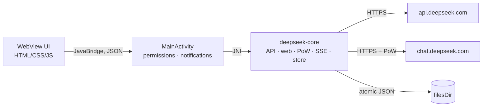

# Local API DeepSeek

Android-клиент к DeepSeek на Rust. Тонкая Java-оболочка (WebView, системные
разрешения, уведомления), вся логика — в `deepseek-core`: проверка токена,
PoW, потоковый SSE с рассуждениями и локальная история чатов.

Два режима авторизации:

| Режим | Токен | Модель |
|---|---|---|
| **API** | `sk-…` с [platform.deepseek.com](https://platform.deepseek.com/api_keys) | `deepseek-flash` = **DeepSeek-V4.1-Flash-1017**, thinking, усилие `low/high/max` |
| **Web** | `userToken` из `chat.deepseek.com` | веб-сессия DeepSeek, DeepThink включён |

## Что умеет

- Вставка токена, проверка до сохранения (`/models` или `/api/v0/users/settings`),
  подтверждение с режимом и балансом.
- Модели: `deepseek-flash` (V4.1 Flash 1017) и `deepseek-v4-pro` в API-режиме.
  В веб-режиме выбор модели убран: upstream больше не различает
  стандартную/экспертную модель. Рассуждения можно выключить, усилие — `low/high/max` (API).
- Стриминг ответа и `reasoning_content` / `THINK`-фрагментов, отмена генерации.
  Текст появляется мягким затуханием, лента не выдёргивается вниз, если
  пользователь прокрутил её вверх. После ответа видно время ответа, `tok/s`
  (точно по usage в API, оценка в web) и время размышлений в их блоке.
- В шапке чата — оценка занятого контекста (`Контекст ≈ N токенов`) с учётом
  system-инструкции, истории, черновика и грубой оценки изображений.
- После первого ответа отдельный короткий запрос к модели предлагает название
  чата (2–5 слов); оно сохраняется и показывается в истории вместо первого
  сообщения. Это дополнительный расход токенов.
- **Agent mode:** отдельная история в левом меню, приватный workspace на чат,
  журнал workspace/ZIP/JS-ошибок с копированием (для диагностики),
  установщик QEMU + Ubuntu Base (arm64, TCG), отдельный полноэкранный терминал
  и tool-loop: модель выполняет shell-команды в /workspace, может
  распаковывать ZIP (`/bin/busybox unzip`), читать выбранные текстовые файлы
  (до 250 000 символов суммарно, 128 КБ на файл, бинарные пропускаются).
  ZIP загружается **скрепкой в поле ввода** (в агентском режиме она выбирает
  ZIP, в обычном — фото): файл копируется в `/workspace` (≤ 40 МБ), агент
  видит его в списке и сам распаковывает. Публичная SAF-папка и кнопки
  «Папка»/«Очистить» убраны — весь обмен идёт через workspace песочницы;
  удаление файлов доступно агенту и через терминал. Кнопка «Инструменты
  агента» находится в правом меню.
- Markdown в ответах: заголовки `#`…`######`, списки, цитаты, ссылки,
  `**жирный**`, `*курсив*`, `~~зачёркнутый~~`, блоки кода с копированием,
  GFM-таблицы с выравниванием и горизонтальной прокруткой.
- Поиск в интернете: в API-режиме DeepSeek Search (`/v1/tools/search`)
  подмешивает свежие результаты в контекст и показывает источники; в веб-режиме
  включается нативный `search_enabled`. Стоимость — за запрос к Search API.
- Копирование блоков кода отдельно от копирования всего сообщения.
- Длинные сообщения и URL переносятся по словам; горизонтальной прокрутки
  ленты нет.
- Интерфейс в Material Design 3: отдельный полноэкранный экран настроек,
  навигационный drawer, segmented-кнопки, switch, snackbar и собственные
  диалоги подтверждения. Тема (системная/тёмная/светлая), размер текста
  (WebView text zoom), компактный интерфейс.
- Ввод: нативный Android-EditText в нижней панели — WebView-textarea больше не
  участвует в наборе, поэтому IME не теряет символы; при отклонённой отправке
  (нет токена, ошибка сети, остановленный поток) текст возвращается в поле, а
  набранное во время отправки не затирается. Нативная обработка IME-inset
  на API 30+ покадрово через `WindowInsetsAnimation.Callback` (`adjustResize` под
  edge-to-edge не работает); панель едет чуть впереди клавиатуры.
- Параметры модели — в правом меню: чипы модели и поиска открывают шторку
  с Flash/V4 Pro, DeepThink, поиском и усилием. Переключатель «Режим рассуждения» также
  доступен в настройках API («Авторизация и ключи») и синхронизирован со
  шторкой. Каталог настроек: «Авторизация и ключи» (режим нового токена,
  сохранение/проверка), «Локальный API», «Cloudflare Туннель», «О приложении»,
  «Интерфейс». Возврат — «←», закрытие — «✕», системная «Назад» возвращает из
  подменю в каталог.
- Системная инструкция — в правом меню по кнопке-ползункам в чате, рядом с
  чипами модели/поиска. Хранится на устройстве, уходит с каждым запросом
  наверх и не пишется в историю чата.
- Кнопка отправки неактивна, пока поле пустое и нет вложений; при вложениях
  без текста сообщение отправляется с подписью «Опиши изображение».
- Обновления внутри приложения: проверка `update.json`, окно «Обновить / Позже /
  Больше не напоминать», загрузка с прогрессом и установка через системный
  установщик, уведомление о новой версии, тумблер «не напоминать» и ссылка на
  исходный код в настройках.
- Фото: до 4 штук за сообщение, можно выбрать несколько в системном пикере
  сразу; полоса превью 64 dp, просмотр до и после отправки. В API-режиме —
  `image_url` (только `deepseek-flash`), в веб-режиме — загрузка файлов и
  `ref_file_ids`.
- Переключатель доступа к интернету: блокирует все сетевые запросы приложения
  (включая проверку токена и локальный API) и останавливает сервер. Настройка
  сохраняется между запусками.
- Локальный OpenAI-совместимый сервер на `127.0.0.1:8787`; работает и с
  API-ключом, и с веб-сессией. В настройках можно скопировать URL, ключ и
  строку модели.
- История: один JSON-файл на чат, атомарная запись (tmp + fsync + rename).
  В API-режиме в запрос уходит вся история; в web-режиме — `chat_session_id` +
  `parent_message_id`, серверная ветка продолжается.
- Онбординг: `POST_NOTIFICATIONS` и запрос исключения из оптимизации батареи
  (`ACTION_REQUEST_IGNORE_BATTERY_OPTIMIZATIONS`).
- Уведомление «Ответ готов», если ответ завершился, пока приложение свёрнуто.

## Веб-токен

1. Войдите на `chat.deepseek.com`.
2. DevTools → Application → Local Storage → `userToken`.
3. Скопируйте значение целиком. Это JSON `{"value":"…","__version":"0"}`;
   приложение само достанет `value`.

Подробно для Android, Windows, macOS, Linux и iOS — [docs/get-token.md](docs/get-token.md).

Что под капотом: `GET /api/v0/users/settings` (проверка), `chat_session/create`,
`create_pow_challenge` → **DeepSeekHashV1** (SHA3-256 без Keccak round 0),
`chat/completion` с заголовком `x-ds-pow-response`, разбор SSE-фрагментов
`THINK` / `RESPONSE`, `message_id` → `parent_message_id` следующего хода.

**Риски, принятые пользователем:** это неофициальный протокол. DeepSeek режет
такие клиенты (ban wave, `RISK_DEVICE_DETECTED`), эндпоинты меняются без
предупреждения, возможна проверка Cloudflare. API-режим лишён этих рисков.

## Внешний доступ: Cloudflare Tunnel

Настройки → «Локальный API» → включить сервер, затем «Cloudflare Tunnel».
Туннель поднимает `cloudflared` (arm64, встроен в APK) и даёт публичный HTTPS.

### Быстрый туннель

1. Режим «Быстрый», переключатель туннеля → включить.
2. Подтвердить предупреждение.
3. Через несколько секунд появится `https://…trycloudflare.com`.

Аккаунт Cloudflare не нужен. URL живёт, пока туннель запущен, и меняется после
перезапуска. Cloudflare ограничивает такие туннели; для постоянного адреса —
именованный.

### Именованный туннель

1. Cloudflare Zero Trust → Networks → Tunnels → Create a tunnel.
2. Public hostname → service `http://127.0.0.1:8787` (порт из настроек приложения).
3. Скопировать tunnel token.
4. В приложении режим «Токен», вставить токен и публичный адрес, включить.

Рекомендуется закрыть hostname политикой **Cloudflare Access**: URL туннеля —
это фактически вход в локальный API.

### Безопасность

- Локальный API всё равно требует `Authorization: Bearer <ключ>`.
- Ключ даёт доступ к вашему токену DeepSeek: не публикуйте URL и ключ.
- Быстрый туннель — временный и без SLA; именованный — стабильный.
- Туннель останавливается вместе с foreground-сервисом локального API.
- Токен именованного туннеля не сохраняется на диск: после перезапуска
  приложения его нужно вставить снова.
- `cloudflared` не умеет DNS на Android (`/etc/resolv.conf` отсутствует),
  поэтому приложение само регистрирует quick tunnel через API, резолвит edge-IP
  через Android и передаёт `cloudflared` явные `--edge` адреса. TLS-сертификаты
  берутся из встроенного CA-bundle (`SSL_CERT_FILE`).
- Origin для quick tunnel идёт через **Unix-сокет** `files/localapi.sock`, а не
  через TCP `127.0.0.1`. Это обходит VPN/прокси, которые перехватывают
  локальные TCP-соединения приложения.
- При обрыве edge-соединения `cloudflared` перезапускается (до 4 раз) с теми же
  credentials, поэтому URL быстрого туннеля может сохраниться.

## Локальный API

Настройки → «Локальный API» → включить. Сервер слушает только loopback,
использует ключ, сгенерированный приложением, и текущий режим приложения
(официальный API-ключ или веб-сессию).

```bash
curl http://127.0.0.1:8787/v1/models \
  -H "Authorization: Bearer <ключ из настроек>"

curl http://127.0.0.1:8787/v1/chat/completions \
  -H "Authorization: Bearer <ключ из настроек>" \
  -H "Content-Type: application/json" \
  -d '{"model":"deepseek-flash","messages":[{"role":"user","content":"ping"}],"stream":true}'
```

Эндпоинты: `GET /v1/models`, `POST /v1/chat/completions` (stream и non-stream),
`GET /health`. Работает, пока приложение в foreground-сервисе; при убийстве
процесса сервер останавливается. Из компьютера по USB:
`adb forward tcp:8787 tcp:8787`.

Локальный API по умолчанию **быстрый**: reasoning выключен. Включить его
можно только явно — `"thinking": {"type": "enabled"}` (или `"thinking": true`)
либо `"model": "deepseek-reasoner"`. Один `reasoning_effort` DeepThink больше
не включает: значение используется как настройка усилия, когда reasoning уже
включён.

Для длинных ответов ставьте `"stream": true`. Проверено на живом веб-токене:
заголовки и первый SSE-чанк приходят за **~0.3 с**, тогда как `stream: false`
отдаёт тело только после полного ответа. Если клиент просит reasoning и не
стримит, DeepThink может занять минуту — это не зависание сервера, а
особенность non-stream запроса.

Веб-режим: локальный API создаёт одну веб-сессию и переиспользует её до
остановки сервера (тогда удаляет). Массив `messages` каждый раз передаётся
модели как транскрипт (System/User/Assistant); нативной серверной ветки нет —
контекст держится в промпте. HTTP-клиент `reqwest` один на весь сервер, поэтому
TLS/DNS и пул соединений не пересоздаются; PoW-челлендж по-прежнему решается на
каждый completion (его выдаёт DeepSeek).

## Архитектура



- `core/` — `deepseek-core`: `reqwest` (rustls), SSE-парсеры обоих протоколов,
  `pow.rs` (DeepSeekHashV1), `server.rs` (локальный OpenAI-прокси на tiny_http),
  хранилище, движок стримов с опросом снапшота. SSE читается построчно через
  `BufReader`, поэтому разрыв `data:`-строки между TCP-чанками не теряет токен.
  Web-фрагменты принимаются массивом, объектом или JSON-строкой; `active`
  фрагмент сохраняется между снапшотами THINK → RESPONSE.
- `android/` — cdylib `liblocalapi.so`, 11 JNI-функций, JSON-конверт
  `{ok, data}` / `{ok:false, error:{kind,message}}`.
- `app/` — Gradle-проект: Java 17, minSdk 26, targetSdk 35, без AndroidX.
- UI не делает сетевых запросов: только `Native.*` и рендер.

Поток: `send` пишет сообщение пользователя на диск и запускает фоновый поток;
JS опрашивает `poll` каждые 60 мс и получает накопленный текст. Ответ
сохраняется по завершении или отмене.

## Сборка

Нужны: Rust + targets, Android SDK 35, NDK, JDK 17+.

```bash
rustup target add aarch64-linux-android x86_64-linux-android
export ANDROID_HOME=$HOME/Android/Sdk
export ANDROID_NDK_HOME=$ANDROID_HOME/ndk/27.0.12077973   # опционально
./build.sh
```

`build.sh` собирает `liblocalapi.so` под `arm64-v8a` и `x86_64`, кладёт их в
`jniLibs` и запускает `gradlew assembleDebug`.

APK: `app/app/build/outputs/apk/debug/app-debug.apk` (debug-подпись).
Готовый артефакт: `dist/localapi-deepseek-1.6.37-debug.apk`.

## Обновления

Приложение при запуске читает публичный
`https://raw.githubusercontent.com/Rewixx-png/localapi-deepseek/main/update.json`
и сравнивает `versionCode` с установленным. Если версия новее, показывается окно
с тремя кнопками: «Обновить», «Позже», «Больше не напоминать». «Обновить»
скачивает APK с прогрессом и процентом и передаёт его системному установщику
(`PackageInstaller`), поэтому новая версия должна быть подписана тем же ключом.
SHA-256 из манифеста проверяется до установки.

При первом запуске приложение один раз проверяет разрешение на установку из
неизвестных источников и при необходимости открывает системные настройки.
Фоновая проверка (`JobScheduler`, раз в 6 часов) присылает уведомление о новой
версии; настройки → «Приложение» → «Не напоминать об обновлении» отключает и
окно, и уведомления. Там же кнопка «Проверить» и ссылка на исходный код.

Формат `update.json`:

```json
{
  "versionCode": 51,
  "versionName": "1.6.37",
  "url": "https://github.com/Rewixx-png/localapi-deepseek/releases/download/v1.6.37/LocalApiDeepSeek.apk",
  "sha256": "…",
  "notes": "Что изменилось"
}
```

После сборки новой версии: загрузить APK в GitHub Releases, обновить
`versionCode`/`versionName`/`url`/`sha256` в `update.json` и запушить `main`.

## Проверка

```bash
cargo test -p deepseek-core        # 20 e2e + 13 unit-тестов
python3 tools/ui-smoke.py          # UI-потоки в headless Chromium (playwright)
```

Покрыто: обе проверки токена (включая HTTP 200 + `code=40003`), нормализация
JSON-обёртки `userToken`, официальный SSE (reasoning/content/usage), веб-SSE
(`THINK`/`RESPONSE`, snapshot + append + finish), PoW на векторах официального
WASM, продолжение веб-ветки по `parent_message_id`, сохранение истории и режима
после перезапуска, отмена с частичным ответом, удаление, path traversal,
права `0600` на `auth.json`, локальный сервер (auth, non-stream, chunked SSE
с проверкой, что первый чанк уходит до завершения апстрима, веб-бэкенд),
офлайн-режим (блокировка запросов и сохранение состояния), поиск (Search API
подмешивается в system-контекст, источники сохраняются в истории), изображения
(API content parts и веб-загрузка с `ref_file_ids`).

Вручную: сборка APK (badging, JNI-символы совпадают с `native`-методами),
живой TLS к `api.deepseek.com` (401) и к `chat.deepseek.com`
(`{"code":40003,"msg":"Authorization Failed (invalid token)"}`) с заведомо
неверными токенами. UI: headless Chromium проверяет MD3-потоки, копирование кода, диалог удаления
чата, офлайн-режим и отсутствие горизонтального переполнения.

На физическом устройстве/эмуляторе не запускалось:
в окружении сборки нет KVM.

## Данные и приватность

- `filesDir/auth.json` — режим + токен, права `0600`, `allowBackup="false"`.
- `filesDir/conversations/<id>.json` — сообщения, рассуждения, id веб-сессии.
- Прокси и сторонних серверов нет; запросы идут напрямую в DeepSeek.

## Ограничения

- Веб-режим неофициальный: без cookie браузера, WAF может потребовать
  `cf_clearance`; при смене протокола режим сломается.
- `auto_continue` (WIP-продолжение очень длинных рассуждений) не докачивается:
  стрим закрывается по `finish`.
- `REQUEST_IGNORE_BATTERY_OPTIMIZATIONS` — чувствительное разрешение; для
  Google Play нужна декларация, для sideload работает как есть.
- Уведомление о готовности требует, чтобы процесс пережил сворачивание.
- Модель умеет vision, но UI пока текстовый.
