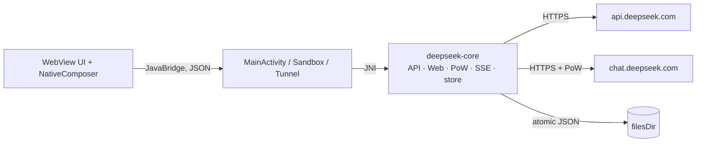

# Local API DeepSeek

Android-клиент DeepSeek на Rust. Вся логика работает в `deepseek-core` (авторизация, PoW, потоковый SSE, локальная история и прокси-сервер), на стороне Java остаётся только оболочка (WebView, нативная строка ввода, разрешения, уведомления, QEMU и `cloudflared`).

Два режима авторизации:

| Режим | Токен | Модель |
|---|---|---|
| **API** | `sk-…` с [platform.deepseek.com](https://platform.deepseek.com/api_keys) | `deepseek-flash` (`DeepSeek-V4.1-Flash-1017`) и `deepseek-v4-pro`, thinking, усилие `low/high/max` |
| **Web** | `userToken` с `chat.deepseek.com` | веб-сессия DeepSeek, переключатель DeepThink |

## Возможности

- **Проверка токена до сохранения** (`/models` или `/api/v0/users/settings`) с показом режима и баланса (в API-режиме).
- **Стриминг и рассуждения**: потоковый вывод `reasoning_content` / `THINK`, отмена генерации в любой момент, статистика времени ответа, `tok/s` и времени размышлений. Автопрокрутка ленты не перехватывает скролл, если вы листаете вверх.
- **Контекст и автоназвания**: оценка занятых токенов в шапке чата (с учётом system-инструкции, истории, черновика и вложений). После первого ответа отдельный короткий запрос генерирует название чата (2–5 слов).
- **Фото и медиа**: до 4 изображений за сообщение через системный пикер (превью 64 dp и полноэкранный просмотр). В API-режиме уходят как `image_url` (`deepseek-flash`), в веб-режиме загружаются файлами с `ref_file_ids`.
- **Форматирование**: Markdown (заголовки, списки, цитаты, ссылки, GFM-таблицы с выравниванием и прокруткой, блоки кода с подсветкой `highlight.js`, номерами строк, копированием и предпросмотром HTML), формулы LaTeX через локальный KaTeX (`\(...\)`, `\[...\]`, `$...$`, `$$...$$`) и оформление текста тегом `[[font:serif|...]]` (`sans`, `mono`, `cursive`, `condensed`, `light`, `black`).
- **Поиск в интернете**: DeepSeek Search (`/v1/tools/search`) в API-режиме с выводом источников; нативный `search_enabled` в веб-режиме.
- **Системная инструкция и параметры**: в правом меню настраиваются модель, рассуждения, усилие (`low/high/max`), веб-поиск и системная инструкция (хранится локально, в историю чата не пишется).
- **Офлайн-переключатель**: блокирует любые сетевые запросы приложения и останавливает локальный сервер.
- **Интерфейс и ввод**: Material Design 3, системная/тёмная/светлая тема, настройка масштаба текста и компактного режима. Поле ввода реализовано нативным Android `EditText` с покадровой обработкой клавиатуры (`WindowInsetsAnimation.Callback` на API 30+).
- **Уведомления и автообновления**: уведомление «Ответ готов», если генерация закончилась в фоне; проверка `update.json` (при запуске и раз в 6 часов через `JobScheduler`), проверка SHA-256 и установка через системный `PackageInstaller`.

## Режим агента (песочница и браузер)

Отдельная история чатов в левом меню и изолированный `/workspace` на каждый чат.

- **QEMU + Ubuntu Base (arm64, TCG)**: постоянный ext4-образ (`rootfs.img`), установленные пакеты и файлы за пределами `/workspace` сохраняются между запусками. Настройки памяти и ядер задаются в диалоге песочницы.
- **Сеть внутри песочницы**: `eth0` (`10.0.2.15`, шлюз `10.0.2.2`) и встроенный Java HTTP-прокси приложения на `10.0.2.2:18991` (пробрасывается и в `apt`, и в `http_proxy`/`https_proxy`), чтобы сеть в госте работала даже поверх Android VPN с fake-IP. Время UTC синхронизируется при старте, доступна команда `install-base` (`curl`, `ca-certificates`, `htop`, `procps`, `python3`, `git`, `wget`, `dnsutils`, `iputils-ping`).
- **Tool-loop и файлы**: модель выполняет shell-команды в `/workspace` с построчным выводом в сворачиваемых блоках (таймаут 2 минуты, для `apt-get` и `install-base` — 15 минут). ZIP-архивы до 40 МБ прикрепляются скрепкой прямо в `/workspace`, агент видит файлы и распаковывает их сам. Готовые фото, аудио и видео до 12 МБ агент может присылать в чат через `[[SEND: /workspace/file]]`.
- **Браузер агента**: встроенный `WebView` с сохранением cookie/сессии и командами `[[BROWSER: open|URL]]`, `click|CSS`, `type|CSS|текст`, `scroll|down`, `extract`, `screenshot`, `back`, `forward`, `reload`. Скриншот уходит в модель как изображение для мультимодального зрения.
- В правом меню доступны инструменты агента: журнал ошибок и полноэкранный терминал Ubuntu.

## Веб-токен

1. Войдите на [chat.deepseek.com](https://chat.deepseek.com).
2. Откройте DevTools → Application → Local Storage → `userToken`.
3. Скопируйте значение целиком (подойдёт как JSON `{"value":"…","__version":"0"}`, так и сама строка `value`).

Подробная инструкция для ПК, Android и iOS — в [docs/get-token.md](docs/get-token.md).

Под капотом: `GET /api/v0/users/settings`, `chat_session/create`, `create_pow_challenge` → **DeepSeekHashV1** (SHA3-256 без Keccak round 0), `chat/completion` с заголовком `x-ds-pow-response`, разбор SSE (`THINK` / `RESPONSE`), цепочка `message_id` → `parent_message_id`.

**Ограничения веб-режима**: это неофициальный протокол. DeepSeek периодически режет такие клиенты (баны, `RISK_DEVICE_DETECTED`), меняет эндпоинты или требует Cloudflare-проверку. Для стабильной работы используйте официальный API-ключ.

## Локальный API

Включается в настройках («Локальный API») и работает в foreground-сервисе (`ServerService` с `WakeLock`/`WifiLock`) на `127.0.0.1:8787` и Unix-сокете `files/localapi.sock`. Требует `Authorization: Bearer <ключ>` из настроек.

```bash
curl http://127.0.0.1:8787/v1/models \
  -H "Authorization: Bearer <ключ из настроек>"

curl http://127.0.0.1:8787/v1/chat/completions \
  -H "Authorization: Bearer <ключ из настроек>" \
  -H "Content-Type: application/json" \
  -d '{"model":"deepseek-flash","messages":[{"role":"user","content":"ping"}],"stream":true}'
```

Эндпоинты: `GET /v1/models`, `POST /v1/chat/completions` (`stream: true/false`), `GET /health`. С ПК по USB можно пробросить порт: `adb forward tcp:8787 tcp:8787`.

- Рассуждения по умолчанию выключены для быстрого отклика. Включаются явно через `"thinking": {"type": "enabled"}` (`true`) или `"model": "deepseek-reasoner"`. `reasoning_effort` настраивает усилие только при уже включённом thinking.
- Для длинных ответов используйте `"stream": true`: первый чанк приходит сразу (~0.3 с), тогда как при `stream: false` ответ отдаётся целиком после завершения генерации.
- В веб-режиме сервер использует одну веб-сессию до своей остановки (потом удаляет её), передавая историю `messages` транскриптом.

## Внешний доступ: Cloudflare Tunnel

В настройках можно поднять встроенный `cloudflared` (arm64) для публичного HTTPS поверх локального API:

- **Быстрый туннель**: временный URL `https://…trycloudflare.com` без аккаунта Cloudflare. Живёт до остановки туннеля и меняется после перезапуска.
- **Именованный туннель**: Cloudflare Zero Trust → Networks → Tunnels → Public hostname с сервисом `http://127.0.0.1:8787`. Токен вставляется в приложении (на диск не сохраняется). Рекомендуется дополнительно закрыть домен через Cloudflare Access.

Особенности работы на Android: DNS edge-узлов резолвится средствами Java и передаётся через `--edge` (так как на Android нет `/etc/resolv.conf`), сертификаты берутся из встроенного `cacert.pem` (`SSL_CERT_FILE`), трафик в локальный API идёт по Unix-сокету `files/localapi.sock` в обход перехвата VPN, при обрыве связи выполняется до 4 автоперезапусков.

## Архитектура



- `core/` (`deepseek-core`) — `reqwest` (rustls), построчный SSE-парсер (`BufReader`), PoW (`pow.rs`), локальный сервер (`server.rs` на `tiny_http`), атомарное хранилище.
- `android/` — `cdylib` `liblocalapi.so`, 17 JNI-методов (`Rust.java`), JSON-конверт `{ok, data}` / `{ok:false, error:{kind,message}}`.
- `app/` — Gradle-проект: Java 17, `minSdk 26`, `targetSdk 35`.
- Взаимодействие в чате: `send` сохраняет сообщение и запускает фоновый поток, UI опрашивает `poll` каждые 60 мс.

## Сборка

Нужны: Rust + targets (`aarch64-linux-android`, `x86_64-linux-android`), Android SDK 35, NDK, JDK 17+.

```bash
rustup target add aarch64-linux-android x86_64-linux-android
export ANDROID_HOME=$HOME/Android/Sdk
export ANDROID_NDK_HOME=$ANDROID_HOME/ndk/27.0.12077973   # опционально
./build.sh          # debug APK
./build.sh release  # подписанный release APK
```

`build.sh` скачивает `cloudflared` и библиотеки QEMU (с проверкой SHA-256), собирает `liblocalapi.so` под `arm64-v8a` / `x86_64` и упаковывает APK. Релизы публикуются во вкладке [Releases](https://github.com/Rewixx-png/localapi-deepseek/releases).

## Обновления

Манифест `update.json` (основной запрос через GitHub Contents API, запасной — raw CDN):

```json
{
  "versionCode": 68,
  "versionName": "1.11.7",
  "url": "https://github.com/Rewixx-png/localapi-deepseek/releases/download/v1.11.7/LocalApiDeepSeek.apk",
  "sha256": "…",
  "notes": "Что изменилось"
}
```

## Тесты

```bash
cargo test -p deepseek-core        # unit- и e2e-тесты ядра
python3 tools/ui-smoke.py          # UI-потоки в headless Chromium (playwright)
```

## Приватность и ограничения

- `filesDir/auth.json` — режим и токен (права `0600`, `allowBackup="false"`).
- `filesDir/conversations/<id>.json` — переписки и id веб-сессий.
- `REQUEST_IGNORE_BATTERY_OPTIMIZATIONS` — чувствительное разрешение для Google Play (для прямой установки APK работает без ограничений).
- Уведомление о готовности ответа срабатывает, если процесс приложения не был выгружен системой в фоне.
